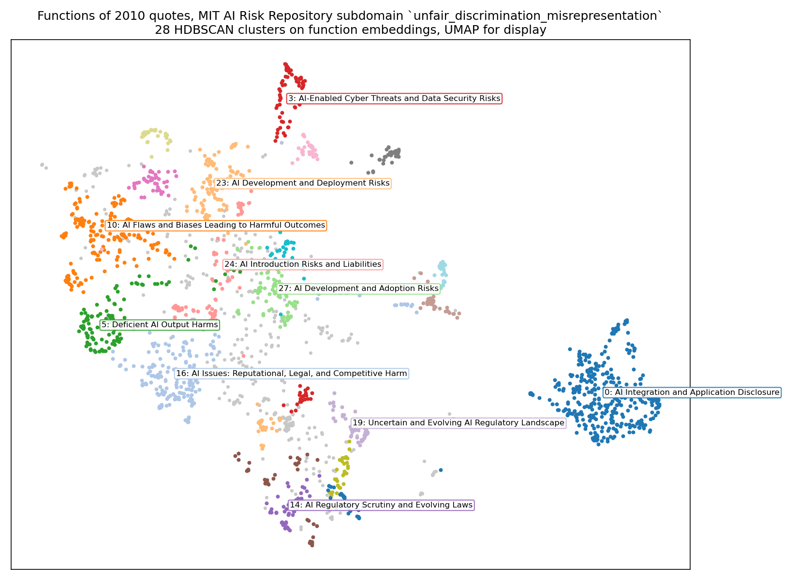
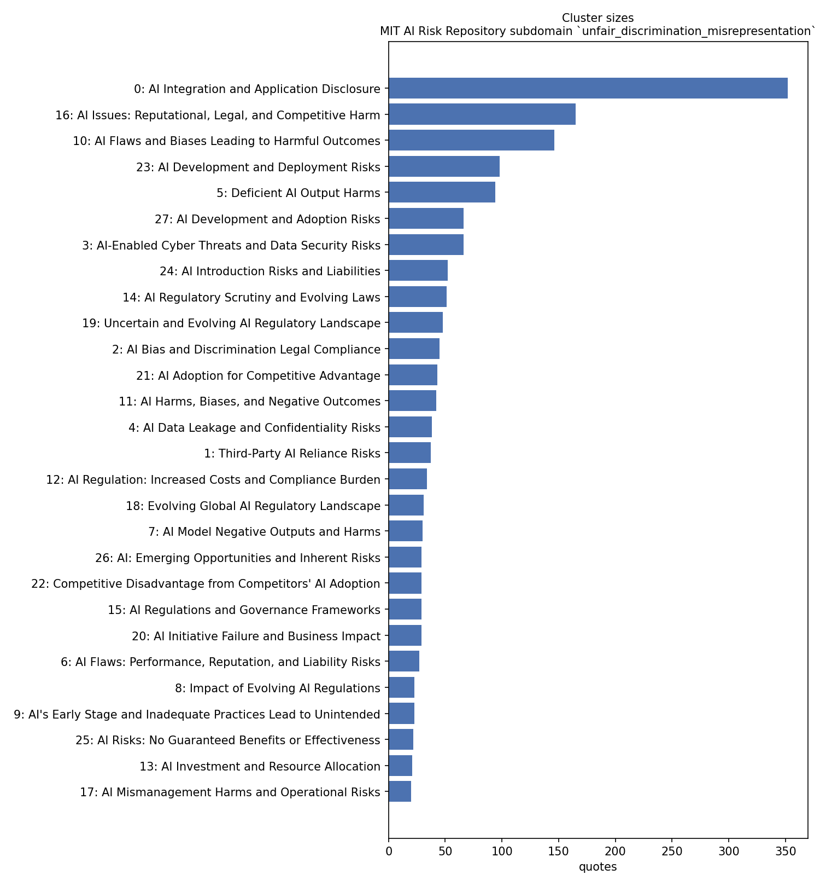

# Functional fragmentation of AI disclosures

The method of Evalet (Kim, Lee, Lee, Seering, Kim: *Evalet: Evaluating Large Language Models
by Fragmenting Outputs into Functions*, CHI 2026, [arXiv 2509.11206](https://arxiv.org/abs/2509.11206);
code [kixlab/Evalet](https://github.com/kixlab/Evalet), MIT) without Evalet: one script, six
steps, run on the labelled passages of the AI Risk Observatory's US pipeline.

## The method

1. **Fragments.** Evalet asks an LLM to cut each text into the fragments relevant to a
   criterion. Here that step is already done: the classifier of the US pipeline stores one to
   three verbatim evidence quotes with every label, and every quote carries the passage's
   labels (roles, risk types, MIT subdomain, disclosure traits, substantiveness) and the
   filing's industry (ISIC division) and month. A subset is chosen by label, not by a free-text
   criterion.
2. **Functions.** One short abstract description per quote of what the sentence does in the
   disclosure (Evalet's "abstract fragments into features": distinct, generalizable, abstract,
   interpretable, concise). `gemini-2.5-flash`, temperature 0, 40 quotes per request.
3. **Embeddings** of the function descriptions (`gemini-embedding-001`, 3,072 dimensions).
4. **Clusters.** UMAP to ten dimensions (cosine), HDBSCAN there (scikit-learn). Evalet clusters
   on a two-dimensional projection, which over-merges at this size; density clustering on the
   raw embeddings leaves most points unclustered (59 % on this subset). A second UMAP to two
   dimensions serves the map only.
5. **Names.** Evalet's base-cluster prompt: one summary sentence and a name of at most ten words
   per cluster, from a sample of its functions against a sample of other clusters' functions.
6. **Report.** Cluster table with sizes, shares, industries, months; a map; a size chart.

No rating of fragments as positive or negative: the passages are described, not scored.

## Example: MIT subdomain 1.1, unfair discrimination and misrepresentation

Run `us-2025h1_V3` (7,794 US filings of 2025 H1, taxonomy v0.9): 777 passages labelled with
the subdomain, 2,010 quotes. Cost of the model calls: under USD 0.50.

28 clusters, 320 quotes (16 %) in no cluster. The largest:

| Cluster | Quotes | Share |
|---|---|---|
| AI integration and application disclosure | 352 | 18 % |
| AI issues: reputational, legal and competitive harm | 165 | 8 % |
| AI flaws and biases leading to harmful outcomes | 146 | 7 % |
| AI development and deployment risks | 98 | 5 % |
| Deficient AI output harms | 94 | 5 % |
| AI development and adoption risks | 66 | 3 % |
| AI-enabled cyber threats and data security risks | 66 | 3 % |
| AI introduction risks and liabilities | 52 | 3 % |
| AI regulatory scrutiny and evolving laws | 51 | 2 % |
| Uncertain and evolving AI regulatory landscape | 48 | 2 % |

Full table: [`results/unfair_discrimination_misrepresentation/clusters.md`](results/unfair_discrimination_misrepresentation/clusters.md).





What the example shows: the quotes of a passage labelled with subdomain 1.1 are not all about
discrimination. The largest cluster (18 %) states the company's own AI use; discrimination
proper sits in clusters 10, 2, 14 and 8 (about 13 % together), surrounded by generic
risk-listing clusters. The method separates what the sentences do from what the passage was
labelled with, which is the point of running it.

What it does not show: whether the function descriptions and cluster names are right. They
are model text. The check is a sample of quotes read against their function and cluster by
two people.

## Running it

```
pip install -r requirements.txt
python functional_fragmentation.py all \
    --run gs://<bucket>/<run> --subdomain unfair_discrimination_misrepresentation \
    --project <gcp project> --location us-central1
```

`--role <role>` or `--trait <trait>` select by role or disclosure trait instead. Each step is
also a sub-command (`fetch`, `describe`, `embed`, `cluster`, `name`, `report`); `describe`
resumes where it stopped. Model calls go through Vertex AI in the given project and need
`gcloud auth application-default login`. `--min-cluster-size` overrides the HDBSCAN minimum
(default: quotes / 100, at least 5).

Quotes and embeddings stay in `work/` (git-ignored). `results/` holds counts, names,
summaries and plots.
